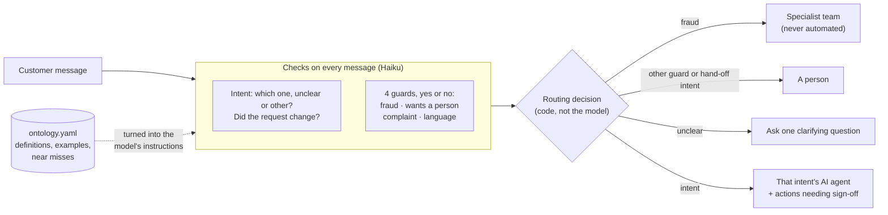

# BrownBox intent routing

An intent ontology for routing BrownBox's customer support conversations to specialised AI
agents, a router that applies it one customer message at a time, and an evaluation that says
how good the router is, when to stop improving it, and how to keep it working once it's live.

| Tested once on 56 conversations it had never seen | Result | 95% interval |
|---|---|---|
| Right agent when the customer's request becomes clear | **86%** | 74–93% |
| Right intent when the customer's request becomes clear | **79%** | 66–87% |
| Conversations where it wrongly changed intent | **9%** | 4–19% |
| Conversations where a guard fired wrongly | **0%** | 0–7% |
| Cost per conversation (Haiku 4.5) | **$0.038** | |

After that test I fixed what it exposed (v3). v3 passes all 44 hand-written guard and switch
cases, including 13 fraud cases.

**Contents:** [Quick start](#quick-start) ·
[1. The ontology](#1-the-ontology) ·
[2. System design](#2-system-design) ·
[3. Evaluation](#3-evaluation) ·
[4. Keeping it working](#4-keeping-it-working-without-stakeholders) ·
[5. Path to production](#5-path-to-production) ·
[6. Limitations](#6-limitations) ·
[7. How I used AI](#7-how-i-used-ai) ·
[8. Repository map](#8-repository-map)

## Quick start

```bash
uv sync && cp .env.example .env    # Python 3.12; add ANTHROPIC_API_KEY to .env
make parse                         # split the conversations (fixed seed)
make all                           # format, lint, type-check, tests (no network)

make demo                          # the main flows: fraud, switches, guards, triage
uv run route "I can't log in and I don't know why"   # try your own messages
make eval-cases                    # the 44 hand-written cases
make eval                          # the 85 practice conversations
make eval-locked                   # the locked test set (only for the version it was labelled against)
make eval-guards                   # guard precision and recall, pooled on the current ontology version
```

Saved results are in [`results/eval/`](results/eval/). Re-running calls the API (about $6 with
Haiku for all three sets) and can differ slightly, because the model isn't fully deterministic.
Only the `conversation` column is used; the `issue_*` columns were never loaded.

In `uv run route`, when the router says "unclear", a separate small model call writes a clarifying
question that names the likely requests, and it goes into the transcript as the agent's reply. That's
a demo convenience: it isn't part of the router or the evaluation.

## 1. The ontology

**28 intents in 7 domains, 4 guards, 8 agents**, in [`ontology/ontology.yaml`](ontology/ontology.yaml)
(validated on load; readable as [`ONTOLOGY.md`](ontology/ONTOLOGY.md)).

### 1.1 Exploratory data analysis

**The data.** 1,000 synthetic conversations (generated with GPT-3.5). Three contain only an
agent's sign-off and no customer message, so I dropped them. Before looking at anything else I
split the rest: **697 DEV** to build the ontology, **200 practice** to tune the router, **100
locked** for the final test. The figures below are DEV and practice only.

| What I looked at | What I found | What it meant for the design |
|---|---|---|
| Speakers | 30 different staff labels (Agent, Supervisor, Billing Team…); 68 conversations pass between staff | Parse "Customer" vs everyone else; staff hand-offs are evidence of escalation |
| Length | Median 8 customer messages and 17 turns; customer messages median 11 words | Routing must happen per message, not once per conversation |
| How requests open | Most say what they want in the first message; some open vaguely ("I have an issue with my order") | An "unclear" outcome that asks one question, rather than a forced guess |
| Mixed requests | About 1 in 10 adds a second request; a few switch request | Track second requests and switches; don't treat follow-ups as switches |
| Fraud | None in the data | The fraud guard is tested on hand-written cases instead |

**Reading first, then clustering.** I read 25 conversations by hand and wrote notes before
seeing any model output ([`notes/reading-notes.md`](notes/reading-notes.md)). Then Opus
summarised each DEV conversation's goal in one line, and I embedded and clustered the summaries.
Cluster quality kept improving as I allowed more clusters, so there's no natural number of
intents; I deliberately made 35 (sizes 62 down to 6), because merging by hand is easier than
splitting. Results: [`results/discovery/`](results/discovery/).

**Why customers get in touch** (200 practice conversations): returns and refunds **29%**, account
and login 17%, product support and warranty 14%, delivery 12%, payments 12%, orders 10%, shopping
help 5%. The largest single intent is returning or reporting a faulty item (23%). **94% are
conversations the AI could take part in**; the rest ask for a person (9), ask to close an
account (2), make a complaint (1) or fit no intent (1).

### 1.2 What earns an intent

The ontology exists to route, so an intent must pass three tests, in order:

1. **The router can tell it apart from the customer's words.** If it takes BrownBox's data to
   tell two cases apart (tracking, account state), they're one intent whose procedure branches.
2. **It needs a different procedure:** different steps, tools, policy or risk.
3. **It carries at least 1% of conversations,** unless it's a risk route, which costs little to
   keep.

**Intents are split by procedure and risk; agents are grouped by knowledge.** "Return an item"
(identity check, refund sign-off) and "return policy" (a question, no checks) are two intents
for one returns agent. Mixing them up still reaches the right agent, so I score intent and agent
separately.

### 1.3 Structure

| Domain | Intents (agent) |
|---|---|
| Orders | Check order status, Cancel an order, Change delivery or pickup address (orders) |
| Delivery | Order not arrived, Arrange a redelivery, Get faster delivery (delivery); Delivery charges (knowledge) |
| Returns and refunds | Return, replace or report a faulty item; Return policy; Chase a refund (returns) |
| Payments and offers | Dispute a charge, Get an invoice, Offers and discounts, Loyalty points (billing); Listed prices (knowledge) |
| Product and warranty | Warranty information, Warranty claim (warranty); Installation help (knowledge) |
| Account and login | Can't log in or verify, Unlock account, Reset password, Change email, Reactivate, Sign-up (account); Close account (a person) |
| Shopping help | How to order, pay and collect; Out-of-stock items; Shipping to an unavailable location (knowledge) |

Each intent also records:

- **Who takes part:** the AI, a person (closing an account, for data protection) or never.
- **Risky actions that need a person's sign-off.** The AI prepares them and a person approves:
  a refund outside policy, a refund to a different payment method, waiving a fee, unlocking an
  account, changing the account email. A standard refund to the original payment method is an
  AI action. Ten intents have sign-off actions; the rest of each conversation stays with the AI.
- **Planned hand-overs.** A procedure can find out what the customer needs and then pass the
  conversation on: a faulty item is troubleshot first, then replaced or refunded within the
  return window, or handed to the warranty agent for a repair.
- **Fraud signals** for its procedure to check in BrownBox's systems, such as repeated "not
  received" claims on one account.

### 1.4 Guards

Four yes/no checks run on every customer message and override any intent.

| Guard | Then | Example that fires | Example that doesn't |
|---|---|---|---|
| Fraud or account takeover | Specialist team, never automated | "I never placed this order" | "My parcel was stolen from my doorstep" |
| Asks for a person | A person | "I'd like to speak to someone who can help" | "Can you check with your team how long it takes?" |
| Complaint | A person | "I want to make a formal complaint" | "This is unacceptable, I demand a refund" (the request, said angrily) |
| Unsupported language | A person | A message mostly in Spanish | "Café Olé" as a product name |

When a guard fires, the AI stops for the rest of the conversation, pending sign-offs are
cancelled, and anything already done is listed for review.

### 1.5 How the ontology changed

1. **v1:** from the 35 clusters, I decided the merges and splits
   ([`notes/ontology-v1-proposals.md`](notes/ontology-v1-proposals.md)).
2. **v2:** labelling exposed weak boundaries ([`notes/edge-cases.md`](notes/edge-cases.md)).
   Customers report faults, not remedies, and can't always say why they can't log in. That led
   to the triage pattern (see 2.2) and tighter guards.
3. **v3:** fixes for what the locked test exposed (see 3.2).

### 1.6 Assumptions and constraints

- An intent is what the customer wants done, judged from their words, not from what the agent
  found in BrownBox's systems.
- One primary intent per conversation, plus an optional second request; a switch is when they
  drop one request for another.
- Each intent maps to one procedure and one agent; the agents themselves are out of scope.
- BrownBox's policies (return windows, refund rules) live in the procedures; I assumed standard
  online-retail ones.
- The AI never takes part in suspected fraud, not even to ask a question.
- English only, as a configurable list.
- No stakeholders: every decision came from the data and my judgement, written down with its
  reason.

## 2. System design

### 2.1 Architecture



Solid arrows are what happens to each message. The dotted arrow is set-up: the ontology file
becomes the instructions and examples the model is given, so changing the YAML changes the
checks without changing code. Every customer message goes through this, so the route can change
mid-conversation.

### 2.2 Design choices

| Design choice | Why |
|---|---|
| **The model classifies; code decides** whether the AI takes part | Participation is a policy lever, so it shouldn't depend on a prompt |
| **Code decides when to switch intent**; the model only says whether the request changed | The model followed the topic of follow-ups ("how long will my refund take?") and switched wrongly in 28% of conversations |
| **A separate yes/no check per guard,** sticky once fired | Checked together with the intent, guards fired on frustration and on "thanks, bye" |
| **Sign-off on risky actions, not whole intents** | A person approves a refund outside policy; the AI still handles the rest of the conversation |
| **Triage instead of asking:** "can't log in" checks the account; "it's not working" troubleshoots, then hands over to returns or warranty | Customers often can't say which procedure they need; the systems can find out |
| **Few-shot prompts, structured output** | Each intent shows real DEV conversation openings; each guard shows examples that should and shouldn't fire. Answers are typed, never parsed from text |
| **Haiku 4.5**, five checks in parallel | Fast and cheap: about $0.005 per message. The intent check and the four guard checks don't depend on each other, so they run in parallel: a new message takes a couple of seconds |

## 3. Evaluation

### 3.1 Design, and why

| Decision | Why |
|---|---|
| **Split first:** 697 DEV, 200 practice, 100 locked | The locked set stays unseen until the router is frozen, so it gives an honest score. The code refuses to open it without a flag |
| **Ground truth labelled by me**, not by a model | A model can't be the judge of a model. 30 labelled blind first, then 55 with two models' suggestions (Claude Sonnet 5.5 and Opus 5.5): every case where they disagreed, plus a random 30 where they agreed, as an audit. The other 115 are trusted only as far as the audit (83% on every field) |
| **44 hand-written cases** | Real data has almost no switches or guards and no fraud at all. The cases test fraud mid-conversation, traps that must not fire, switches and follow-ups. Drafted with Claude; I reviewed each one and made the disputed calls (e.g. a family member ordering by mistake isn't fraud) |
| **Scored at the message where the request becomes clear**, and at every message | Routing happens per message. "Unclear" before the customer has said what they want isn't counted as wrong |
| **Right intent and right agent, separately** | A wrong intent for the same agent costs little; a wrong agent costs a lot |
| **Wrong intent changes and real switches** | A router that flips on follow-ups breaks the conversation even when its first answer was right |
| **Guard recall, precision and delay** | Fraud needs recall; a person-request guard that over-fires wastes people's time |
| **95% intervals on everything** | 56 conversations is small; an interval stops me over-reading a few points |

### 3.2 Results

I improved the router step by step on the practice set, froze it, then tested it once on 56
locked conversations.

| Step | What I changed | Why | What happened (practice unless stated) |
|---|---|---|---|
| **v1** | First ontology and router | Starting point | 91% right intent, but it wrongly changed intent in 28% of conversations and fired a guard wrongly in 9% |
| **v2** | Ontology fixes from labelling | Customers often can't name the procedure they need | Wrong changes 24%, wrong guards 5% |
| **Round 1** | Code decides switches | It followed the topic of follow-up questions | Wrong changes 16% |
| **Round 2** | A separate check per guard | Guards fired on frustration and closing messages | Wrong changes 9%, wrong guards 0%, 38/38 cases. **Frozen** |
| **Locked test** | Nothing: scored once, unseen | Practice was used for tuning, so it flatters | **79% right intent, 86% right agent**; wrong changes (9%) and wrong guards (0%) held up |
| **v3** | Fixed what the test showed | It missed "I'd like to speak to someone"; delivery-process questions had no clear home | 44/44 cases; every request for a person caught; still no wrong guards |

**Why the locked score is lower:** of its 12 wrong intents, 5 were the router following the
ontology's own wording where my label didn't, 3 were genuine boundary calls, and about 4 were
real errors. **Why v3 isn't scored on the locked set:** I used it to find what v3 fixes, so it's
no longer unseen. The locked numbers stay the headline.

<details><summary>Full numbers, guards and per-intent results</summary>

| Haiku 4.5 | v1 | v2 | Round 1 | Round 2 | **Locked** | v3 |
|---|---|---|---|---|---|---|
| Right intent when the request becomes clear | 91% | 92% | 94% | 91% | **79%** | 89% |
| Right agent when the request becomes clear | 92% | 93% | 96% | 93% | **86%** | 92% |
| Cohen's κ (agreement beyond chance) | 0.90 | 0.91 | 0.93 | 0.90 | **0.77** | 0.88 |
| Conversations with a wrong intent change | 28% | 24% | 16% | 9% | **9%** | 11% |
| Conversations with a wrong guard | 9% | 5% | 6% | 0% | **0%** | 0% |
| Requests for a person caught | 7/7 | 7/7 | 7/7 | 6/7 | **2/3** | 7/7 |
| Hand-written cases passed | 34/38 | 36/38 | 36/38 | 38/38 | | 44/44 |
| Cost per conversation | $0.012 | $0.012 | $0.012 | $0.039 | **$0.038** | $0.039 |

Practice is 85 conversations, locked 56. Differences between round 2 and v3 on practice are
within the intervals.

**Guards** (recall, then precision):

| Guard | v3: cases + practice (129) | Locked (56) |
|---|---|---|
| Fraud | 13/13, 13/13 | none expected |
| Asks for a person | 13/13, 13/13 | 2/3, 2/2 |
| Complaint | 2/2, 2/2 | 0/5, none fired |
| Language | 2/2, 2/2 | none expected |

In both columns no guard fired wrongly. The locked misses were all recall: in v2 I'd tuned the
examples so hard against false alarms that plain requests for a person slipped through, so v3
makes that guard fire when unsure. All fraud examples are hand-written; real fraud recall is
unknown.

**Per intent:** most intents have only one to four labelled conversations, so per-intent
precision and recall (in `results/eval/`) show where to look rather than how good an intent is.
The clearest weak spot: delivery-process questions, 3 of the 12 locked errors.

</details>

### 3.3 Good enough, and when to stop

Good enough depends on what each error costs, so each measure gets its own bar:

| Bar | Why this bar | Now |
|---|---|---|
| Fraud recall: no misses on the fraud cases | A missed fraud case lets the AI act for an attacker | 13/13 |
| Right agent: interval's lower bound ≥ 85% before unsupervised traffic | A wrong agent means the wrong procedure runs; the lower bound, not the average, has to clear it | 74% (locked): **not yet** |
| Wrong intent changes ≤ 10% | A flip mid-conversation restarts the customer's request | 9% |
| Wrong guards ≤ 5% | Each false alarm sends a customer to a person for nothing | 0% |

**Verdict: good enough to trial alongside people, not yet to route on its own.** In a trial it
suggests a route and a person decides, and real traffic narrows the wide interval.

I stopped tuning after three measured steps, by a rule set in advance: targets met, remaining
errors within one agent or genuine boundary calls, the last change inside the previous
interval, or three rounds. v3 wasn't more tuning: it fixed failures the test exposed, each with
a regression case.

### 3.4 Trade-offs I'm least sure about

- **Splitting by procedure creates boundaries customers don't see.** Most locked errors sit on
  lines like "delivery charges vs ordering help". Fewer, broader intents with branching
  procedures might generalise better, at the cost of coarser reporting.
- **The complaint guard.** People and the model disagree on it most. Dissatisfaction may need a
  satisfaction signal rather than a hand-off.
- **Precision versus recall per guard.** Pushing false alarms to 0% cost recall on requests for a
  person; the right balance needs real traffic.

## 4. Keeping it working without stakeholders

### 4.1 Watch

With no one to ask, the conversations are the signal. Weekly, from production logs:

| Signal | What a change means |
|---|---|
| **"Other" rate** | Customers want something new. Cluster these conversations: a group reaching 1% of traffic is a candidate intent |
| **"Unclear" rate**, per intent | A boundary has blurred, or customers word something new |
| **Guard flag rates** | A wording problem, or a real change such as a fraud campaign or a policy customers are angry about |
| **Escalation rate per intent** (resolution rate once outcomes are logged) | The intent's procedure or definition isn't working |

### 4.2 Review

A person labels every hand-over, every guard firing and a random sample of AI conversations.
Those reviewed labels become the next evaluation set, so ground truth always comes from people,
not from the model being tested. An automatic judge of finished conversations ("was the request
resolved?") decides which ones a person should look at first.

### 4.3 Change

Every change is a versioned edit to `ontology.yaml`, always run against the 44 cases as a
regression suite:

- **Add an intent** when a cluster passes the three tests in 1.2: write its definition and
  boundaries, add hand-written cases for its edges, and ship only if no existing intent
  regresses.
- **Retire or merge** an intent under 1% for several weeks, or one whose errors are mostly with
  one neighbour on the same agent. Labels record the ontology version, so the affected
  conversations can be found and relabelled.
- **Change a definition** the same way, with the cases as the regression suite.
- **Add a language** once its procedures exist and a labelled sample passes the same bars. The
  ontology doesn't change; the language guard is a setting, not a limit of the router.

## 5. Path to production

### 5.1 What breaks first

If a real BrownBox stakeholder used this tomorrow:

- **Real wording.** Customers write vaguer, longer messages with several requests and typos.
  Expect more "unclear" and more boundary errors than on clean synthetic text.
- **The soft boundaries the locked set already found:** delivery charges vs ordering help,
  warranty cover vs a claim.
- **Real fraud.** The 13/13 is on hand-written cases; real attempts will be phrased in ways I
  didn't think of.
- **Policies I had to assume.** Return windows and refund rules decide many branches; a wrong
  policy makes the right route give the wrong answer.

### 5.2 What it would take to ship

1. **Simulate first.** Replay BrownBox's past conversations and synthetic edge cases through the
   router. No customer sees it.
2. **Then a trial alongside people.** On live conversations it suggests a route and a person
   decides. This narrows the locked set's ±10-point interval and finds the soft spots in real
   wording, at no risk to customers.
3. **Turn intents on one at a time, lowest risk first.** The ontology already records the risk:
   the six knowledge intents only answer questions from policy, so they go first; anything that
   moves money or changes an account goes last, with sign-off on every risky action. Each intent
   turns on once it clears the bars on real traffic.
4. **An off-switch per intent:** set its participation to `handoff` in `ontology.yaml`. A config
   change, not a code change.
5. **If the model is down, don't send everyone to people:** fail over to the same model on
   another cloud, then to a backup model with its own tested prompt, and only send what none of
   them can route to a person. A malformed answer is retried, not failed over, and a failed call
   is never turned into a default answer. (Planned, not built here.)
6. **Per-customer configuration:** supported languages, which guards are on, and sign-off
   thresholds are settings, not code.
7. **At volume, cut cost:** train a cheap first-pass classifier on reviewed traffic, and keep
   the LLM for the uncertain rest.

## 6. Limitations

- **Synthetic, clean, English data with no real fraud.**
- **One labeller (me).** I measured agreement with models (100% on intent), not with a second
  person.
- **The router and the pre-labelling models are all Claude models,** so they may share blind
  spots. The locked set is labelled by me alone.
- **I labelled 56 of the 100 locked conversations for time:** a random sample, so the score is
  fair, with a ±10-point interval. I left the other 44 unlabelled rather than filling them with
  model labels from the same family as the router.
- **Practice was used for tuning,** so practice scores are optimistic by design; the locked
  score is the one to trust.
- **Few examples per intent** (a median of two labelled conversations), so per-intent
  precision and recall are indicative only.

## 7. How I used AI

### 7.1 Who did what

I built this with Claude Code. I made the design decisions; Claude researched, proposed options,
wrote and tested the code, and pushed back when it disagreed. Where I changed its course:

- **Sign-off on the risky action, not the whole intent** (it proposed intent-level).
- **Test set size:** I rejected a 50-conversation test set as too small.
- **Faulty items:** I proposed troubleshoot-then-hand-over; it found the case too rare for its
  own intent, so I made it a branch of returns.
- **Labelling load:** I cut 170 assisted labels to 55, with a random audit.

### 7.2 How I checked its work

- My own reading came before any model summary.
- My blind labels came before any model suggestion.
- The locked set stayed unopened until the router was frozen.
- Every refactor was re-run and compared.
- A separate agent reviewed the code; its findings are fixed or listed.
- Tests check the committed files themselves: the split reproduces from the raw data, labels come
  only from the split they claim, the ontology was built only from DEV conversations, and the
  generated `ONTOLOGY.md` matches the YAML.
- I tested the live tool myself, which is how the person-request guard's miss was found.

Its mistakes were caught by those checks, from API usage written from memory to a guard example
that backfired.

## 8. Repository map

```
ontology/      ontology.yaml (source of truth), ONTOLOGY.md (generated)
eval/          cases.yaml: 44 hand-written guard and switch cases
data/gold/     my labels, the models' pre-labels, corrections (originals kept)
results/       discovery/ (summaries, clusters), eval/ (cases, practice, locked)
notes/         reading notes, v1 proposals, labelling edge cases
src/brownbox/  parse · llm · discover · ontology · prompts · label · prelabel · cases
               classify (router) · route (CLI) · demo · score (metrics) · evaluate (make eval*)
```
